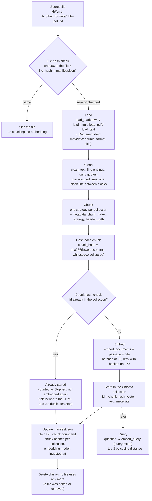

# Pipeline

on vs code, press ctrl + shift + v to see pipeline
How a knowledge base article becomes something the agent can search, and where the pipeline decides to skip work. Code: `rag/ingest.py` (ingest) and `rag/compare.py` (query).

Two checks keep the pipeline cheap and idempotent:

1. **File hash** (`file_hash`, compared with `manifest.json`): an unchanged file is skipped before anything is chunked or embedded. A run with no changes does nothing and takes about 0.2 seconds.
2. **Chunk hash** (`chunk_hash`, used as the Chroma id): a chunk whose text is already stored is never embedded or stored again, whichever file it came from. This is the deduplication step.

## One sentence, end to end

The sentence: *"Remove the printer and re-add it using the IP address."* from the printer article's HTML file, followed through the `markdown_headers` collection.

| Step | What happens to it |
|---|---|
| **File** | `kb_other_formats/03-printer-setup-and-issues.html`, inside `<h3>Printer shows offline</h3>` and a `
` that pandoc wrapped across lines: `…IP address. This fixes the`⏎`problem in nine cases out of ten…` |
| **File hash check** | First run: not in `manifest.json`, so the file is processed. |
| **Load** | `load_html` drops `<head>` and `<style>`, turns the heading into `### Printer shows offline`, keeps the paragraph text, still wrapped. |
| **Clean** | `clean_text` joins the wrapped lines: `Remove the printer and re-add it using the IP address. This fixes the problem in nine cases out of ten. …` After cleaning, the whole HTML article is identical to the markdown article. |
| **Chunk** | `MarkdownHeaderTextSplitter` puts the paragraph in its own section. Chunk 3, header path `Printer Setup and Issues > Common problems > Printer shows offline`, written at the top of the chunk text (296 characters). |
| **Hash** | `chunk_hash` → `0ad7f5b2344cea3a54087936e5b64129e821b7afa10ae784d2eb106bb24a5ca6` |
| **Chunk hash check: deduplication** | The markdown file `kb/03-printer-setup-and-issues.md` was processed earlier in the same run and produced exactly the same chunk with exactly the same hash, so `0ad7f5b2…` is already in the collection. The HTML copy is counted as **Skipped**: not embedded, not stored again. The ingest log shows `kb_other_formats/03-printer-setup-and-issues.html  +0 added … =7 already stored`. |
| **Embed and store** | Happened once, for the markdown copy: passage-mode vector (2048 numbers), stored with id `0ad7f5b2…`, the chunk text, and metadata `source = kb/03-printer-setup-and-issues.md`, `chunk_index = 3`, `strategy = markdown_headers`, `header_path = …`. |
| **Manifest** | Both files' entries in `manifest.json` list `0ad7f5b2…` among their `markdown_headers` hashes. If the markdown file is removed, the chunk stays (the HTML still uses it) and its metadata is pointed at the HTML file. |
| **Query** | `python rag/compare.py ask "My printer shows offline, what do I do?"` embeds the question in query mode and returns the 3 nearest chunks from `markdown_headers`. The hash `0ad7f5b2…` is printed as the id of the chunk that holds this sentence. |

The PDF version of the same article does not deduplicate: a PDF has no heading markup, so its text comes out differently, its chunks get different hashes, and they are stored separately.
